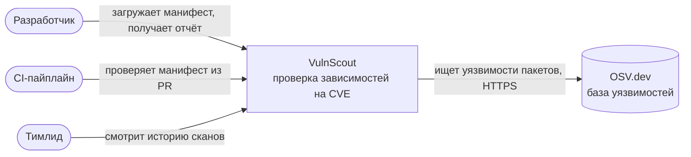
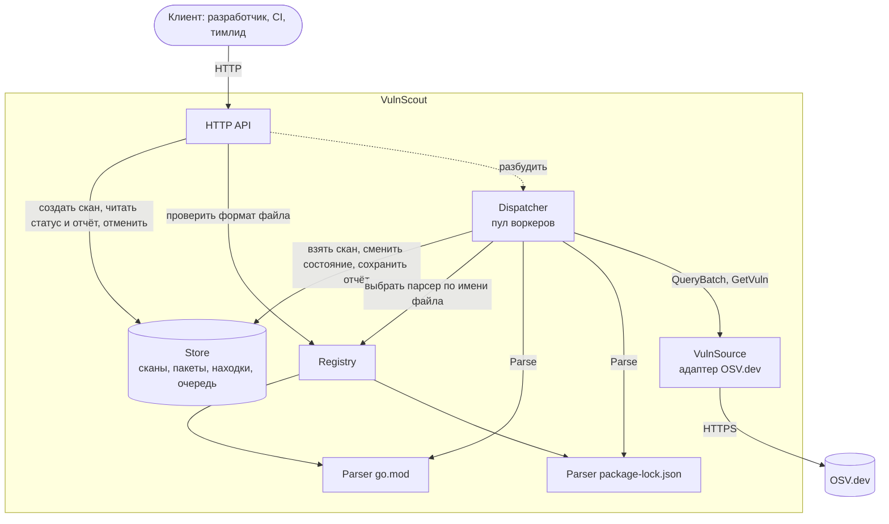
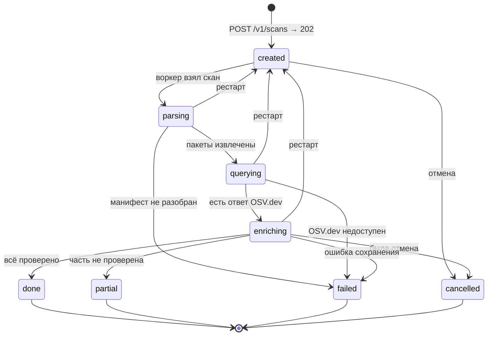

# Архитектура VulnScout

## 1. Контекст

Система целиком, её пользователи и внешние системы (уровень Context в C4).

**Стрелки — вызовы:** кто к кому обращается. Все пользователи работают с VulnScout через HTTP API.
VulnScout сам обращается к OSV.dev; OSV.dev к VulnScout не обращается.

| Элемент | Роль |
|---|---|
| Разработчик | проверяет манифест вручную перед релизом |
| CI-пайплайн | проверяет манифест на каждый PR и роняет сборку выше порога критичности |
| Тимлид | смотрит историю сканов проекта |
| VulnScout | принимает манифест, находит уязвимые зависимости, хранит отчёты |
| OSV.dev | внешняя база уязвимостей с HTTP API |

## 2. Компоненты

Что внутри VulnScout. Всё работает в одном процессе (см. [ADR-0001](adr/0001-one-process-background-scans.md)).

**Стрелки — вызовы во время работы.** Сплошная — синхронный вызов с ответом, пунктир — сигнал без ответа.
Зависимости кода направлены так же, кроме одного места: Dispatcher зависит от интерфейсов `Parser`, `VulnSource`
и `Store`, а не от конкретных реализаций — реализации подставляются при запуске в `main`.

| Компонент | За что отвечает | Что скрывает от соседей |
|---|---|---|
| HTTP API | принимает запросы, проверяет вход, отдаёт ответы и ошибки в едином формате | HTTP, multipart, коды ответов |
| Dispatcher | берёт скан из очереди и ведёт его по состояниям, вызывая Parser и VulnSource | порядок этапов, число воркеров, параллельность запросов |
| Registry | выбирает парсер по имени файла | какие форматы поддерживаются и какой парсер за каким стоит |
| Parser (`go.mod`, `package-lock.json`) | превращает манифест в список пакетов с версиями | синтаксис конкретного формата |
| VulnSource (адаптер OSV.dev) | находит уязвимости пакетов и их детали: CVE, критичность, версию с исправлением | API и формат ответов OSV.dev, таймауты, повторы, расчёт CVSS |
| Store | хранит сканы, пакеты, находки, историю переходов, ключи идемпотентности; служит очередью для воркеров | SQL, СУБД (SQLite или PostgreSQL), блокировки строк |

**Шов для LLM.** Во втором семестре рядом с Parser и VulnSource встанет ещё один исполнитель — `Explainer`:
Dispatcher вызовет его после поиска уязвимостей, чтобы приоритизировать находки и объяснить их.
Остальные компоненты при этом не меняются.

## 3. Диаграмма состояний скана (Job)

**Состояния:** `created`, `parsing`, `querying`, `enriching` — промежуточные; `done`, `partial`, `failed`, `cancelled` — конечные.

**Служебный переход** `parsing | querying | enriching → created` («рестарт») выполняется только при запуске сервиса:
скан, который обрабатывался в момент остановки, возвращается в очередь. После третьей такой попытки скан
переходит в `failed` с ошибкой `worker_lost`.

**Отмена во время работы** не прерывает обработку (см. [ADR-0003](adr/0003-cancel-without-interrupt.md)):
скан помечается к отмене, дорабатывает и в конце вместо `done` или `partial` переходит в `cancelled`.

### Запрещённые переходы

Все переходы проверяет одна функция доменного ядра. Запрещённый переход не выполняется и пишется в лог
с `correlation_id`; состояние скана не меняется.

| Попытка | Пример | Ответ системы |
|---|---|---|
| Любой переход из конечного состояния | отмена завершённого скана | `409` с кодом `scan_finished` и текущим состоянием |
| Пропуск этапа | `created → done`, `parsing → enriching` | внутренняя ошибка: переход отклонён, скан остаётся в прежнем состоянии, в логе ошибка `invalid_transition` |
| Возврат на предыдущий этап | `enriching → querying` | то же: переход отклонён, ошибка в логе |
| Повторный запуск завершённого скана | — | отдельной операции нет; проверить ещё раз — новый скан через `POST /v1/scans` |

Пропуск и возврат этапа может попытаться сделать только код самого сервиса, а не клиент, поэтому клиент их
не видит: такая попытка — ошибка в коде, которую ловят модульные тесты переходов.
